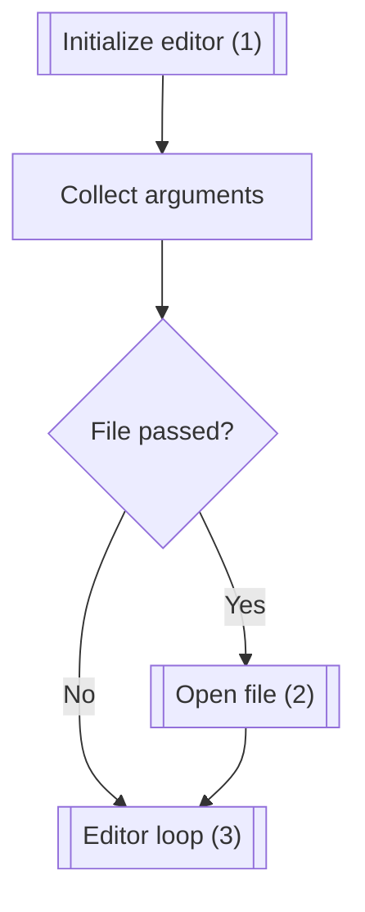
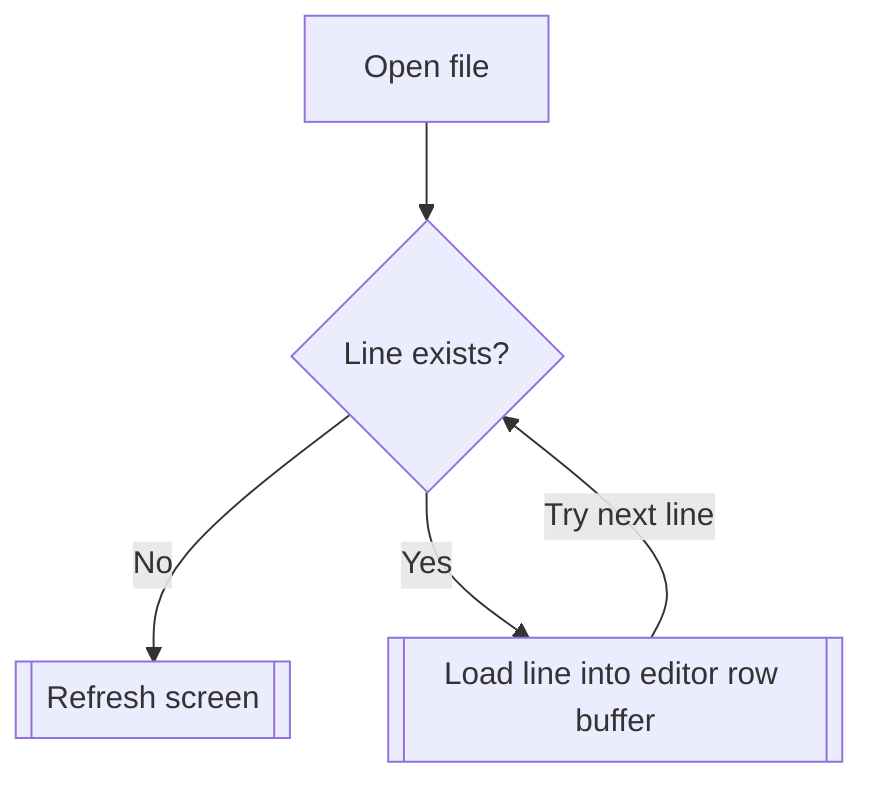
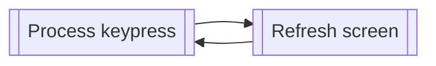

# Kilo

This repository contains _my_ Rust implementation of [antirez's Kilo text editor](https://antirez.com/news/108), traditionally written in C. This is being implemented by following along with the tutorial at https://viewsourcecode.org/snaptoken/kilo/. I've tried to implement the editor in a manner similar to what's described in the tutorial, but due to the differences between Rust and C – or more likely due to my ignorance about the features of Rust – a 1:1 recreation has not been feasible. Either way, I will try to _refrain_ from using anything other than Rust's standard library and the necessary C libraries for this project.

_Disclaimer: This editor is only guaranteed to work on macOS, and even then, probably not all versions._

## Implementation

As of commit 059dd22 (main), the main loop looks like:

All the interesting things happen in blocks (1), (2), and (3).

### 1. Initializing the editor

The editor initialization happens first and is described in `EditorConfig::new()`. That process looks like:

### 2. Opening a file

The process for opening a file happens in `EditorConfig::open()` and looks like:

### 3. Core editor loop

The core editor loop occurs within `main()` and only consists of two processes:

